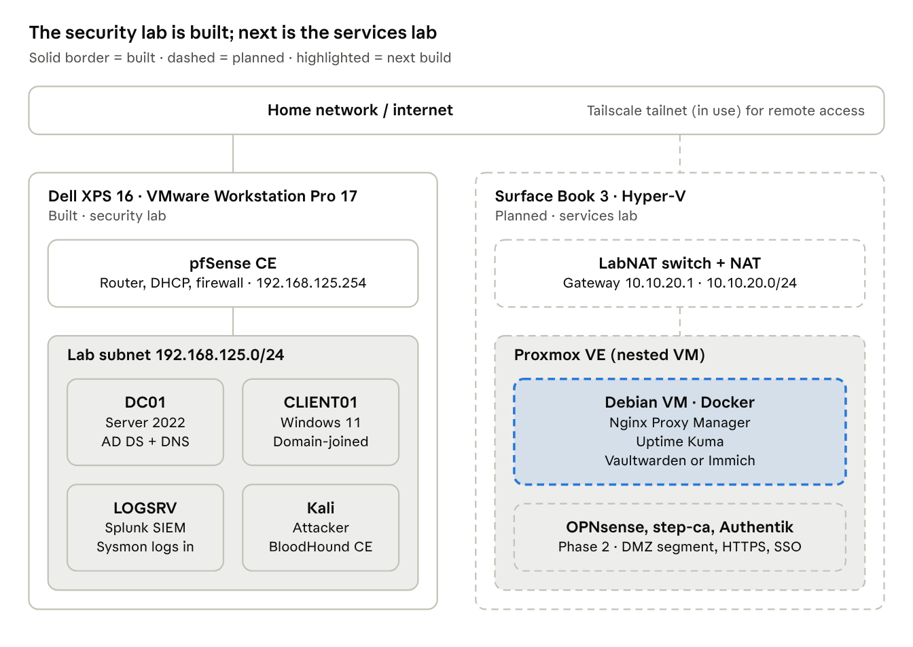

# The Lab

Everything I run, build, break, and fix — from cloud infrastructure to the
hardware on my desk to the software tying it together. This repo is the map:
it documents the whole environment and links out to the deep-dive project repos.

I'm learning in public, one day at a time. The [`journal/`](journal/) folder is
the honest record: what I set up, what broke, how I fixed it, and what I learned.

> [!IMPORTANT]
> Everything I test here runs on hardware I own or VMs I built myself. The
> techniques come from public learning material. Please don't point them at
> anything you don't have permission to touch.

## Objectives

- Run and document real infrastructure across the cloud (AWS, Azure, and GCP planned), on-prem hardware, containers, and virtual labs.
- Practice Windows enterprise skills — Active Directory, Group Policy, Sysmon, Windows Event Logs.
- Collect and investigate security telemetry with Splunk, the ELK Stack, and Microsoft Sentinel.
- Build observability — metrics exporters, Prometheus, Grafana, alerting, and anomaly detection.
- Practice networking: routing, DNS, DHCP, firewalls, VPNs, segmentation, and traffic analysis.
- Run attacks in an isolated lab and prove they are detected.
- Self-host services I actually use, behind a reverse proxy, with my own certificate authority and SSO.
- Test post-quantum cryptography (ML-DSA certificates) in real TLS handshakes.
- Treat mobile and legacy devices as real endpoints to monitor and isolate.
- Document decisions, failures, and fixes as I go.

## The environment at a glance



```text
  ┌─────── AWS ────────┐  ┌──── Azure ─────┐  ┌───── GCP (planned) ─────┐
  │ CloudHub           │  │ Sentinel SIEM  │  │ pqc-poc cross-region    │
  │ Monitoring server  │  │ + honeypot VM  │  │ TLS benchmarking        │
  └─────────┬──────────┘  └───────┬────────┘  └────────────┬────────────┘
            └─────────────────────┼────────────────────────┘
                                  │  Tailscale (private tunnel)
Internet ── TP-Link Archer AX6000 ┤
               │            │     │
          main network   guest network
               │            │
   Dell XPS 16 (hypervisor) │     Samsung Galaxy S5
   Surface Book 3 (Hyper-V) │     (untrusted legacy device)
   iPhones / tablet ────────┘
               │
   ├─ XPS 16 security lab (host-only, behind virtual pfSense)
   │    └─ corp.lab: DC01 · CLIENT01 · LOGSRV (Splunk) · Kali
   │
   ├─ Surface Book 3 services lab (planned — Hyper-V NAT 10.10.20.0/24)
   │    └─ Proxmox VE (nested) → Debian VM + Docker:
   │       Nginx Proxy Manager · Uptime Kuma · Vaultwarden or Immich
   │       Phase 2: OPNsense (LAN + DMZ) · internal CA · Authentik SSO
   │
   └─ Docker (local)
        └─ ELK logging pipeline · sys-exp + docker-exp (Prometheus/Grafana)
           · pqc-poc TLS servers + EJBCA · Gitea
```

Full design: [architecture overview](docs/architecture/overview.md) ·
[network zones](docs/architecture/network-zones.md) ·
[IP plan](docs/architecture/ip-address-plan.md)

## Hardware

| Device | Status | Role |
|---|---|---|
| Dell XPS 16 9640 (Core Ultra 9 185H, 32 GB RAM) | In use | Primary hypervisor host and **security lab** — VMware Workstation Pro and VirtualBox lab VMs; runs the Windows Command Center agent |
| Microsoft Surface Book 3 (i7-1065G7, 32 GB RAM) | In use | **Services lab host** (planned build) — Hyper-V running a nested Proxmox VE; also analysis, documentation, and remote admin |
| TP-Link Archer AX6000 | In use | Home edge router — main and guest networks |
| iPhones | In use | Mobile endpoints — traffic-monitoring subjects and Tailscale clients |
| Tablet (TODO: model) | In use | Mobile endpoint |
| Samsung Galaxy S5 | In use | Unsupported legacy Android device, isolated on the guest network for capture and isolation exercises |
| Lenovo ThinkPad (64 GB RAM, 1 TB) | Planned | Heavy-lab workstation — runs many VMs at once |
| Mini PC | Planned | Bare-metal Proxmox host, so services don't depend on a laptop |
| Raspberry Pi kit | Planned | Pi-hole DNS/DHCP, always-on low-power Linux node |

Full list: [asset inventory](docs/hardware/asset-inventory.md) ·
planned additions: [procurement roadmap](docs/hardware/procurement-roadmap.md)

## Core software

| Component | Role |
|---|---|
| VMware Workstation Pro 17 | Hosts the Active Directory lab |
| Oracle VirtualBox | Hosts the SOC lab |
| Hyper-V | Hosts the services lab on the Surface Book 3 (planned) |
| Proxmox VE (nested) | Hypervisor for the services lab VMs (planned) |
| Docker + Docker Compose | Runs the ELK, monitoring, PQC, and Gitea stacks; will run the services lab apps |
| Nginx Proxy Manager | Reverse proxy for services lab apps (planned) |
| Uptime Kuma | Service health checks for the services lab (planned) |
| pfSense CE (virtual) | Router, DHCP, and firewall for the AD lab network |
| OPNsense | Router and firewall for services lab segments (planned, Phase 2) |
| Authentik | SSO for services lab apps (planned, Phase 2) |
| Windows Server 2022 | Domain controller — AD DS and DNS |
| Windows 11 | Domain-joined endpoint and SOC lab endpoint |
| Ubuntu / Rocky Linux | Linux servers on-prem and in AWS |
| Splunk Enterprise + Universal Forwarder | SIEM for the AD and SOC labs |
| Sysmon (SwiftOnSecurity config) | Windows endpoint telemetry |
| Microsoft Sentinel + Log Analytics | Cloud SIEM for the Azure honeypot lab; queried with KQL |
| Filebeat, Kafka, Logstash, Elasticsearch, Kibana | Centralized logging pipeline |
| Nagios Core | Host and service health checks for the ELK stack |
| Prometheus, Grafana, Alertmanager | Metrics, dashboards, and alerting |
| EJBCA | Self-hosted certificate authority for ML-DSA certificates |
| OpenSSL + Wireshark | TLS handshake testing and packet inspection |
| Kali Linux | Isolated attack box |
| Tailscale | Private remote access — no admin interfaces exposed publicly |

## Projects

| Project | Where | Summary |
|---|---|---|
| [ad-homelab](https://github.com/by-tayo/ad-homelab) | XPS 16 · VMware | Windows Server 2022 DC, domain-joined Windows 11 client, GPOs, pfSense, Sysmon + Splunk telemetry, BloodHound, Kerberoasting attack and detection |
| [Services lab](labs/services-lab.md) | Surface Book 3 · Hyper-V · Proxmox | Planned — self-hosted services behind a reverse proxy, then segmented networks, internal CA, and SSO |
| [azure-soclab](https://github.com/by-tayo/azure-soclab) | Azure | SIEM simulation — exposed Windows 10 honeypot feeding Microsoft Sentinel via Log Analytics; KQL queries and a GeoIP live attack map |
| [elk_stack](https://github.com/by-tayo/elk_stack) | Docker | Centralized logging — Filebeat → Kafka → Logstash → Elasticsearch → Kibana, Nagios health checks, Watcher alerting on error spikes, CI validation |
| [sys-exp](https://github.com/by-tayo/sys-exp) | Docker · multi-device over Tailscale | Host metrics exporter (FastAPI + Prometheus client) with Grafana dashboards, Alertmanager, and IsolationForest anomaly detection |
| [docker-exp](https://github.com/by-tayo/docker-exp) | Docker | Prometheus exporter for Docker Engine usage — container, image, volume, build-cache, and per-container CPU/memory metrics; plugs into sys-exp's stack |
| [pqc-poc](https://github.com/by-tayo/pqc-poc) | Docker · GCP planned | Post-quantum TLS test bed — ML-DSA-44/65/87 certificates from a self-hosted EJBCA CA, TLS and mTLS servers in Python, Java, and JavaScript, benchmarked against classical crypto |
| [AWS monitoring server](labs/aws-monitoring.md) | AWS | TODO: summary and repo link |
| [SOC lab](labs/soc-lab.md) | XPS 16 · VirtualBox | Windows 11 Enterprise + Ubuntu VMs, Splunk SIEM; mobile-device monitoring next |
| [CloudHub](labs/cloudhub.md) | AWS EC2 | Self-hosted Nextcloud; TrueNAS integration planned |
| [Windows Command Center](labs/windows-command-center.md) | XPS 16 + Tailscale | Phone dashboard and control panel for the XPS 16 — token + PIN auth, allow-listed actions, audit log |
| [no-brainer](https://github.com/by-tayo/no-brainer) | Local · Docker | Self-hosted note-taking stack — Obsidian, Gitea, MCP |

Short write-ups for each project live in [`labs/`](labs/).

## Repository map

- [`docs/architecture/`](docs/architecture/) — overview, network zones, IP plan
- [`docs/hardware/`](docs/hardware/) — what I own, and what I plan to add
- [`docs/security/`](docs/security/) — segmentation, access control, threat model
- [`docs/operations/`](docs/operations/) — backups, patching, monitoring
- [`labs/`](labs/) — one summary per project, linking to its repo
- [`runbooks/`](runbooks/) — repeatable step-by-step procedures
- [`journal/`](journal/) — dated build / break / fix notes
- [`infrastructure/`](infrastructure/) and [`automation/`](automation/) — configs and scripts as they're built
- [`assets/`](assets/) — diagrams and sanitized screenshots

## Security principles

- No administrative interface (RDP, SSH, dashboards, hypervisor) exposed to the public internet.
- Remote access only over Tailscale.
- Attack tooling lives only on isolated host-only lab networks — never in the services lab.
- Anything deliberately exposed (like the Azure honeypot) is isolated in its own environment with no real data and no path home.
- Untrusted and legacy devices stay on the guest network.
- Services I depend on run on a different host from destructive testing.
- Secrets never go into Git — only sanitized examples. See [SECURITY.md](SECURITY.md).
- Snapshots before risky changes; restores get tested, not assumed.

## Roadmap

**Now**
- [ ] Services lab Phase 1 on the Surface Book 3 ([runbook](runbooks/hyperv-nat-and-proxmox.md)): Hyper-V NAT, nested Proxmox, Debian + Docker, Nginx Proxy Manager, Uptime Kuma, one daily-use service
- [ ] 3-2-1 backups for lab VMs and service data ([plan](docs/operations/backup-and-recovery.md))
- [ ] Document each device and the real network topology
- [ ] Harden and document the AX6000 ([runbook](runbooks/router-hardening.md))
- [ ] Mobile-device traffic monitoring in the SOC lab
- [ ] First real run of Windows Command Center on the XPS 16
- [ ] pqc-poc: classical baseline and hybrid ML-KEM key exchange

**Next**
- [ ] Services lab Phase 2: OPNsense with LAN + DMZ segments, internal CA for HTTPS, Authentik SSO
- [ ] Pentest the services lab from Kali, publish the report, and turn findings into Splunk detections
- [ ] Get the Raspberry Pi kit and set up Pi-hole DNS
- [ ] Get the ThinkPad (64 GB / 1 TB) for heavy multi-VM labs
- [ ] Add TrueNAS and connect it to CloudHub
- [ ] Deploy pqc-poc to GCP for cross-region handshake benchmarking
- [ ] Revisit the Azure SIEM honeypot lab

**Later**
- [ ] Get the mini PC and move Proxmox from nested on the Surface Book to bare metal
- [ ] Move always-on services (monitoring, logging) from the XPS 16 to Proxmox
- [ ] Terraform-built cyber range on Proxmox
- [ ] Managed switch and real VLANs
- [ ] Configuration automation with Ansible
