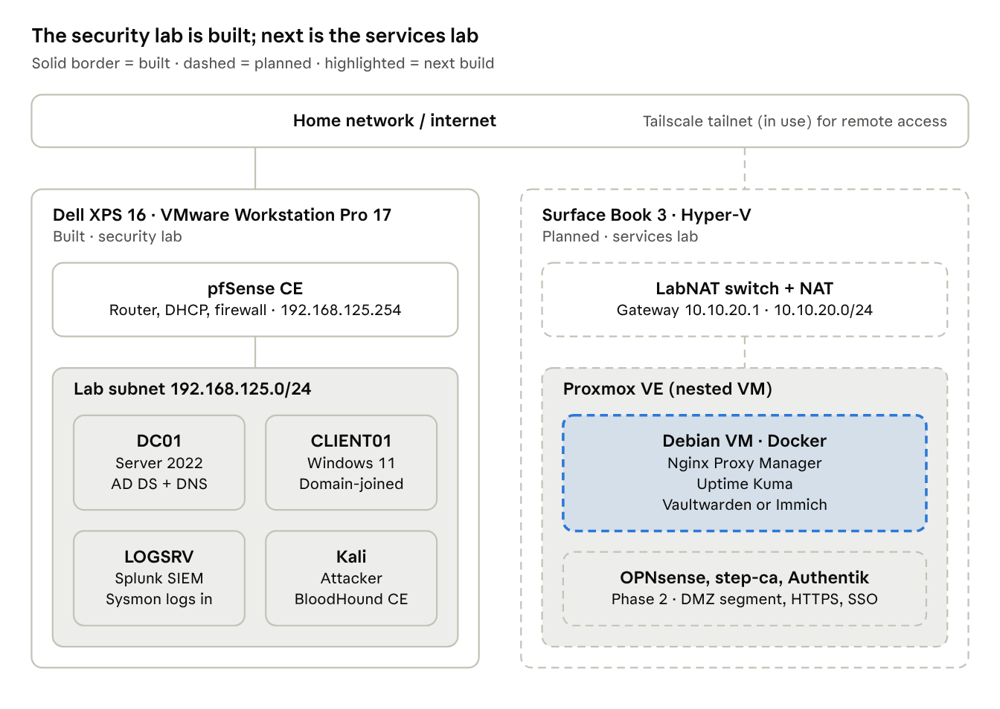

# Architecture Overview

## What this lab is

A personal environment spanning four layers:

1. **Cloud**:
   - **AWS** — CloudHub and a monitoring server
   - **Azure** — a SIEM simulation: an exposed Windows 10 honeypot feeding Microsoft Sentinel
   - **GCP** (planned) — cross-region deployment of the post-quantum TLS test bed
2. **Home network** — a consumer router (TP-Link Archer AX6000) with a main network for trusted devices and a guest network for untrusted ones.
3. **Virtual labs**:
   - **Security lab** — isolated host-only networks on the Dell XPS 16, where the Active Directory and SOC labs run.
   - **Services lab** (planned) — Hyper-V on the Surface Book 3 running a nested Proxmox VE, which hosts self-hosted services in Docker.
4. **Containers** — Docker Compose stacks run locally: the ELK logging pipeline, the sys-exp/docker-exp monitoring stack, the pqc-poc TLS test bed, and Gitea.

## Trust boundaries

| Boundary | Enforced by |
|---|---|
| Internet ↔ home network | AX6000 NAT and firewall |
| Main network ↔ guest network | AX6000 guest isolation |
| Home network ↔ AD lab | Host-only VM network behind virtual pfSense |
| Home network ↔ services lab (planned) | Hyper-V internal switch + Windows NAT on the Surface Book; OPNsense in Phase 2 |
| Services lab LAN ↔ DMZ (planned) | OPNsense firewall rules |
| Remote devices ↔ lab services | Tailscale (private tailnet, no public ports) |
| Internet ↔ AWS services | AWS security groups |
| Internet ↔ Azure honeypot | Deliberately open network security group; isolated in its own resource group |
| Internet ↔ GCP instances (planned) | VPC firewall rules; access via gcloud CLI |

## Design decisions

- **Segmentation happens inside the hypervisor, not on the router.** A consumer router can't enforce firewall rules between lab zones, so the lab networks are host-only or internal virtual networks with a virtual firewall as their gateway.
- **Security lab and services lab live on separate hosts.** Destructive testing (attacks, malware, broken configs) stays on the XPS 16; services I actually use run on the Surface Book 3, so breaking one never takes down the other.
- **VMs over LXC containers for services.** LXC containers share the Proxmox host kernel; apps run in Docker inside a full VM for stronger isolation.
- **Proxmox nested now, bare metal later.** Running Proxmox inside Hyper-V needs no new hardware. It moves to a mini PC once one is bought.
- **SSO for apps, local logins for hosts.** Authentik (Phase 2) gives apps one account, but hosts keep local authentication so an SSO outage can't lock me out.
- **Splunk is the primary SIEM** for the on-prem labs; the ELK Stack runs locally in Docker, and Microsoft Sentinel is used in Azure.
- **One cloud per job.** Each provider hosts the project that fits it, which also means practicing three different IAM and networking models.
- **Tailscale instead of port forwarding** for anything reached remotely.

## Open decisions

- **Internal CA for services lab HTTPS:** reuse EJBCA (already running for pqc-poc, closer to enterprise CLM) or add step-ca (lighter, built for ACME automation).
- **First daily-use service:** Vaultwarden or Immich.
- **Domain:** `lab.home.arpa` only, or a purchased domain later.

## Not yet in place

See the [roadmap](../../README.md#roadmap) and [procurement roadmap](../hardware/procurement-roadmap.md).
